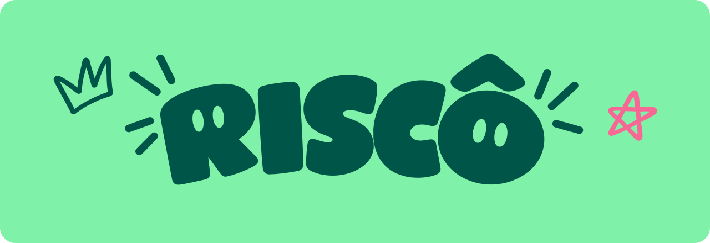
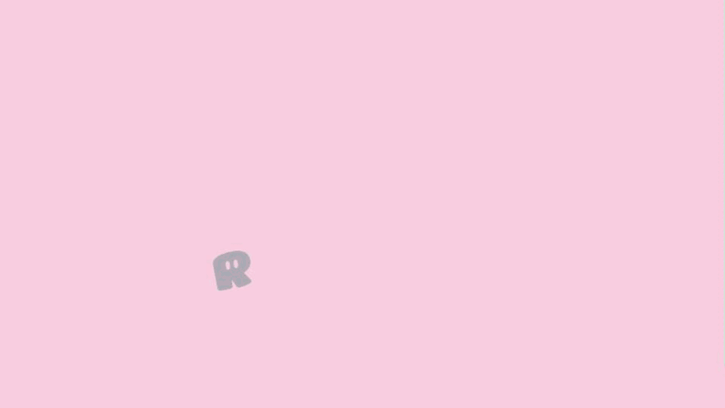
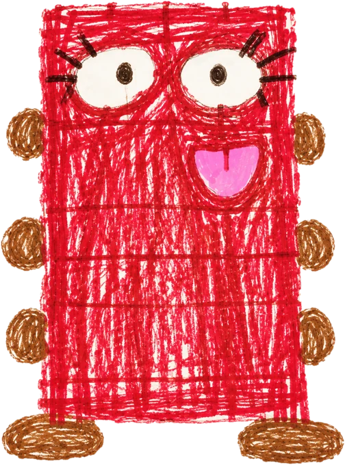
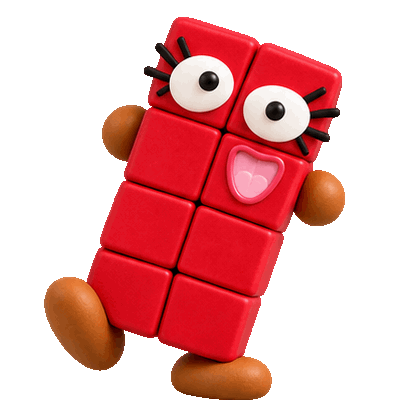
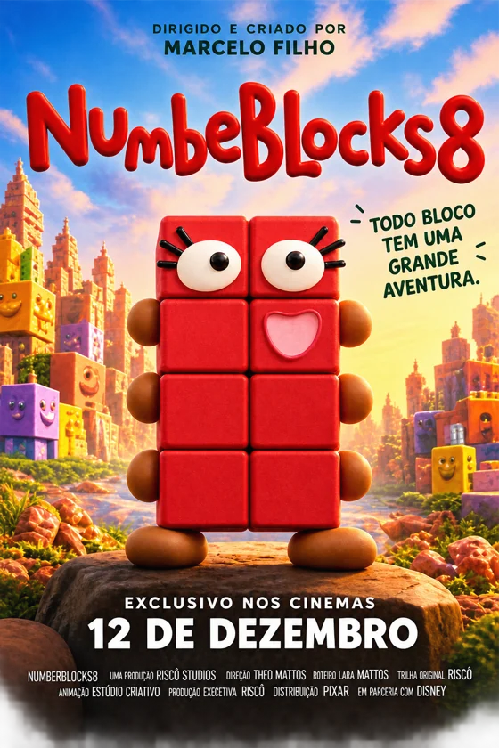
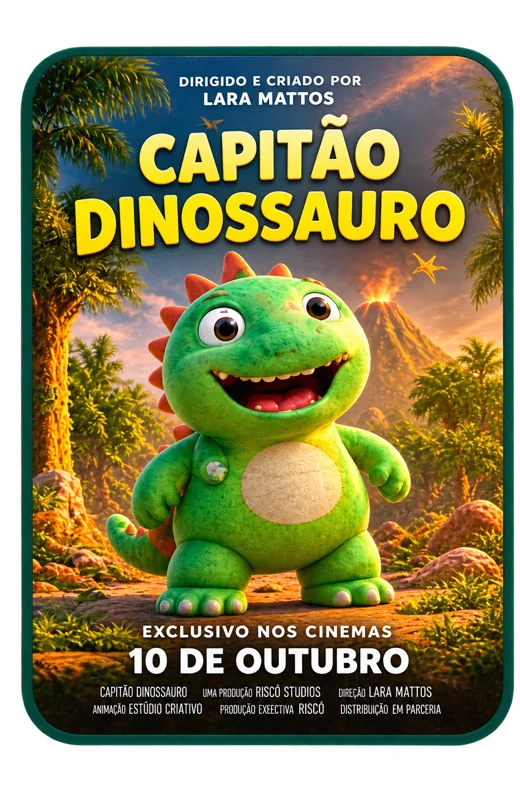
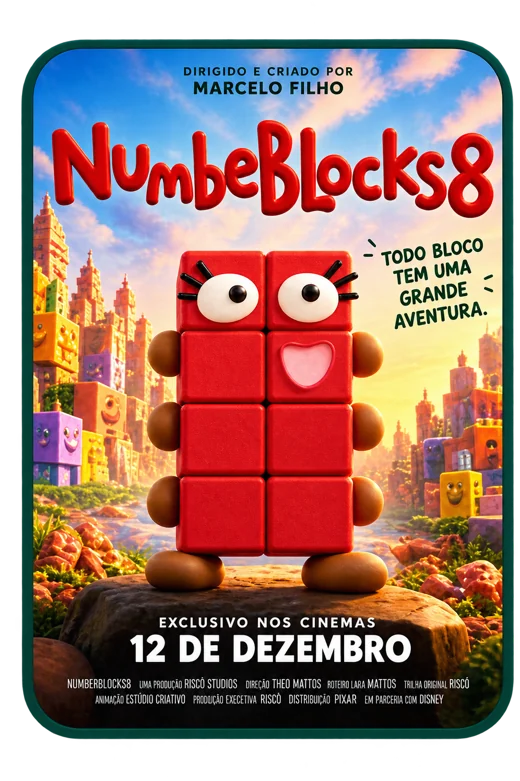
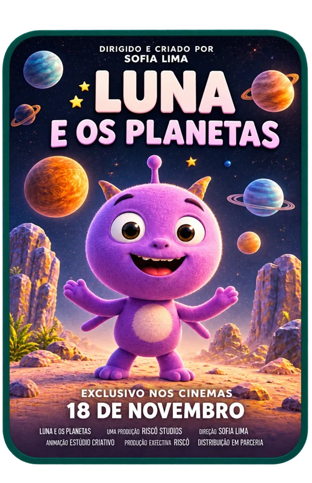
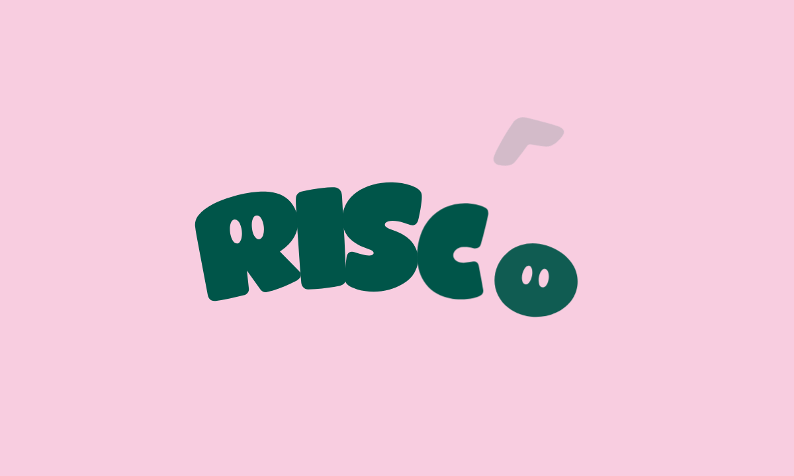
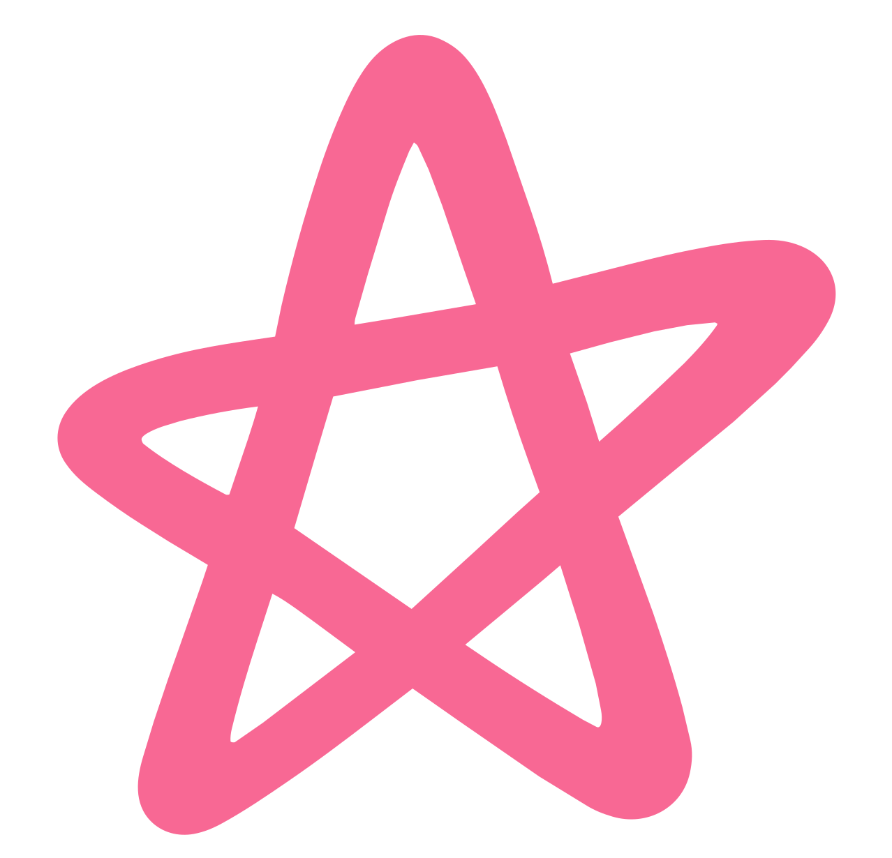

  

<h3 align="center">Todo desenho tem uma grande aventura. ✏️ → 🎬</h3>

  O <b>RISCÔ</b> transforma o desenho de uma criança em um personagem 3D 
  e em um <b>cartaz de cinema</b> só dela, com o nome dela nos créditos.

  

Esta é a vitrine pública do projeto. O código-fonte é privado.

---

  

Gravação real do produto: um desenho enviado no estúdio "Teste aqui" vira o cartaz "Monsterela", gerado por IA na hora.

## O problema

Criança desenha o tempo todo, e quase todo desenho termina esquecido numa gaveta. Pais guardam, fotografam, mas não existe um jeito simples de transformar aquele rabisco em algo que a criança sinta como **dela**, que mereça ser mostrado e celebrado.

## O produto

O RISCÔ pega a foto de um desenho e devolve um **cartaz de filme** com o personagem em 3D, um cenário de aventura e o nome da criança como diretora. Funciona em poucos passos, direto no navegador, sem cadastro.

<table>
  <tr>
    <td align="center" width="33%">
       
      <b>1 · DESENHE</b> 
      A criança cria seu personagem no papel.
    </td>
    <td align="center" width="33%">
       
      <b>2 · TRANSFORME</b> 
      Após digitalizar, a IA transforma o personagem em 3D.
    </td>
    <td align="center" width="33%">
       
      <b>3 · CARTAZ</b> 
      Um cartaz de cinema pronto para compartilhar.
    </td>
  </tr>
</table>

### Pequenos diretores. Grandes histórias.

  
  
  

Além do uso em casa, o RISCÔ é pensado para **eventos**: shoppings, escolas, festas e marcas podem levar a experiência como ativação. O site tem um canal próprio de pedido de orçamento.

## Meu papel

Concebi e conduzi o produto de ponta a ponta: a ideia, o posicionamento, a identidade visual, a direção de arte da página e as decisões de experiência.

Desenhei os elementos da marca (logo, rabiscos, seta, raios, estrela e coroa), defini cada seção a partir de referências e revisei cada entrega no detalhe, de posição e cor até espaçamento e comportamento no celular. A implementação foi feita com o **Lovable** e o **Claude** como pares de engenharia, sob a minha direção.

## Como a experiência foi desenhada

<table>
  <tr>
    <td width="50%"></td>
    <td width="50%">
      <b>Uma abertura com cara de desenho animado.</b> 
      O site começa numa tela rosa com o logo gigante se montando letra a letra. Depois o rosa sobe e revela a página, e o título entra no mesmo ritmo do logo.
    </td>
  </tr>
</table>

| | |
|---|---|
| ✍️ **Feito à mão** | Seta, raios, coroa e estrela são vetores desenhados à mão, cada um com a sua animação de entrada. |
| 🃏 **Seções empilhadas** | Cada seção para no lugar e a próxima sobe por cima, com a curva colorida cobrindo a anterior. |
| 🎴 **Galeria em leque** | Os cartazes chegam empilhados e se abrem como cartas na mão. |
| 📱 **Pensado para o celular** | O topo ocupa exatamente uma tela 9:16, e o formulário de orçamento cabe inteiro, sem rolagem. |
| ♿ **Acessível** | Quem prefere menos movimento vê tudo direto, sem animações. |

## Decisões de produto

- **Fidelidade ao desenho acima de tudo.** O personagem 3D precisa ser reconhecido pela criança. Só o desenho dela entra na geração, sem imagens de referência com outros personagens, e as cores, a silhueta e as proporções do traço são preservadas.
- **Privacidade por padrão.** O desenho e o nome da criança **não são salvos** e não vão para nenhuma galeria pública. O cartaz existe só no aparelho de quem gerou.
- **Sem marcas de terceiros.** A geração proíbe nomes, logos e personagens de estúdios reais.
- **Testar antes de trocar.** Mudanças grandes na página foram validadas primeiro em uma cópia isolada e só depois promovidas.
- **Uma página só.** Tudo cabe em uma página que rola de seção em seção, com o estúdio de cartazes abrindo por cima, sem trocar de tela.

## Construído com

TanStack Start · React · TypeScript · Tailwind CSS · Supabase (Postgres) · IA generativa de imagem com streaming · Lovable

---

   
  Criado por <b>Daniel Medeiros</b> · <a href="https://riscoaventura.lovable.app">riscoaventura.lovable.app</a>

